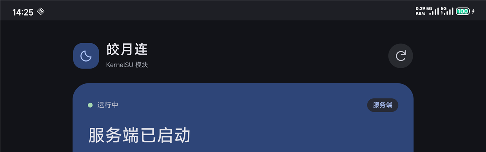
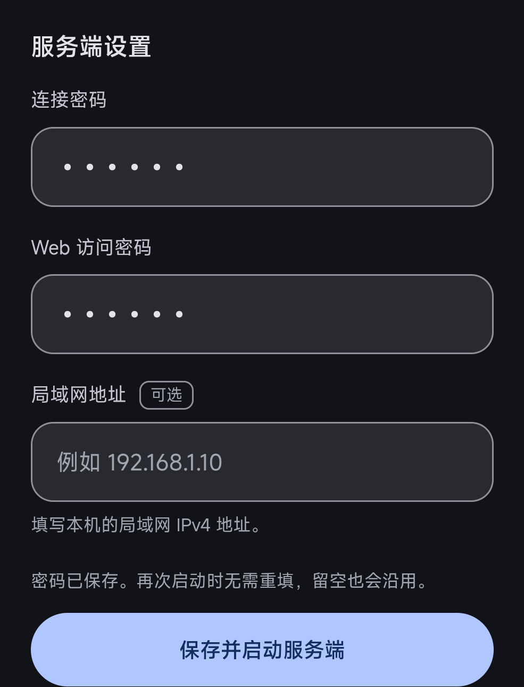

# 皎月连 · KernelSU 常驻模块

**Rust 管理服务 · Material Design WebUI · 作者 Chimiko**

[GitHub 仓库](https://github.com/Mr-Goodname/natpierce-kernelsu) · [下载模块](https://github.com/Mr-Goodname/natpierce-kernelsu/releases) · [反馈问题](https://github.com/Mr-Goodname/natpierce-kernelsu/issues)

> **项目仍处于早期测试阶段。** 使用体验可能不好，也可能遇到连不上、断线或自动恢复失败等问题。现有测试只覆盖有限的设备和网络条件，还有很多情况没测。
>
> 用户已自测确认：使用 Wi-Fi 时，模块手机客户端和服务端都能正常连接。此前代理使用移动数据测试，两种角色均未建立可用隧道，原因尚未确定。公网连接、网络切换、不同 NAT 和长期待机等场景仍需补测，目前适合愿意试用并反馈问题的用户。

把 [皎月连 NATPierce](https://www.natpierce.cn/) 的官方 Linux ARM64 核心运行在 Android root 后台，通过 KernelSU WebUI 管理。保存账号与设备身份，开机恢复登录和连接，关闭管理器后继续组网。

当前测试版本 **v0.2.3**。本仓库开源 Rust 管理服务、Android 网络辅助逻辑、模块脚本和 WebUI。皎月连的登录、P2P 打洞与隧道协议由**未修改的官方核心**完成；本项目没有将私有协议完整重写为 Rust。官方核心不进入 GitHub 源码或 Release 安装包，由使用者在 WebUI 中从官网下载。



上图来自此前的移动数据测试，显示服务已启动，但当时隧道未连通。v0.2.0 的完整界面截图保留在 [验证记录](VALIDATION.md) 中。

## 为什么做这个模块

项目起点是作者在自己手机上遇到的使用问题：退出 App 后需要重新登录、连接，系统显示 VPN 图标，以及后台连接容易中断。这些是该设备上的实际体验，不代表所有 Android 版本、设备或皎月连 App 都有相同表现。

| 使用需求 | Android App 的使用方式 | 本模块的做法 |
| --- | --- | --- |
| 登录与开机恢复 | 本次设备上需要手动重新登录、连接 | 账号与设备身份保存在 root 私有目录，按设置自动恢复 |
| 关闭管理界面 | App 生命周期与后台策略由 Android 管理 | WebUI 只负责管理，关闭管理器后独立后台进程继续运行 |
| VPN 状态栏图标 | 本次 App 组网连接使用系统 VPN 服务 | 直接使用内核 TUN，无 `VpnService`，不创建系统 VPN 图标 |
| 异常退出 | 依赖 App 的后台保活与恢复机制 | root 看护进程、OOM 优先级保护、核心和管理服务自动恢复 |
| 安装条件 | 可直接安装 APK 使用 | 需要 ARM64、KernelSU root、可用 TUN 和模块 WebUI |

目前提供 IPv4 客户端和服务端模式、识别码连接、同账号设备列表、自动启动设置、流量显示、诊断和日志。WebUI 默认青色，可切换动态配色、自定义颜色和深浅模式。连接与后台恢复是否正常取决于设备和网络，已完成的测试见 [VALIDATION.md](VALIDATION.md)。

v0.2.3 修复服务端连接名单不更新的问题。客户端连接或断开后，数量和列表会随核心通知更新；列表显示客户端会话编号与虚拟 IP。官方 Linux 1.06 接口没有提供可可靠关联的真实客户端设备名称，因此当前显示“客户端编号”，不把同账号在线设备名单当作连接名单。

官方 Android App 只作客户端，没有手机服务端功能。这里的手机服务端由模块运行官方 Linux 核心实现，测试时由 Windows 客户端发起连接。官方 App 的客户端对照不能验证或解释模块服务端连接失败。

## 安装与首次使用

需要 ARM64 Android、KernelSU 或兼容管理器的 root 权限、内核 `/dev/net/tun`，以及可用的模块 WebUI。首次下载核心需要手机能够访问皎月连官网下载站。

1. 从本仓库 [Releases](https://github.com/Mr-Goodname/natpierce-kernelsu/releases) 下载 `natpierce_rs_v0.2.3.zip`，在 KernelSU 模块页面安装，按管理器提示重启。
2. 打开模块 WebUI，在连接页的“下载核心”卡中点击“下载核心”；也可进入“设置 → 官方核心”下载。下载完成且 SHA256 校验通过后，管理服务才能运行官方核心。
3. 登录皎月连账号。输入对方识别码、连接密码，或选择同账号的在线设备；也可以在服务端页面配置手机接受连接。
4. 在设置中启用开机自动启动、自动重连，并选择启动后的模式。

初次安装没有官方核心时，模块保持待机并显示下载入口。下载按钮由使用者主动触发；模块不会向 GitHub 或第三方镜像获取官方核心。升级保留已下载的核心、账号与身份记录。

服务端的连接密码和 Web 访问密码保存在手机本地。再次启动服务端或重新打开 WebUI 时，密码框会带回已保存的值，不需要重新输入。修改后启动服务端即可保存新密码；输入失败或保存失败时保留当前填写内容。



若手机 App 或旧测试模块正在使用同名 TUN，请先断开并停用其中一个，避免同时管理同一虚拟网卡。手动“断开连接”会暂停自动回连；重新连接后恢复。诊断把账号登录、控制通道、TUN 路由和实际隧道探测分别显示，不能仅凭“已登录”判断数据已通。

### 官方核心来源

| 项目 | 本次内置验证来源 |
| --- | --- |
| 官方版本 | Linux ARM64 v1.06 |
| 官网 | [natpierce.cn](https://www.natpierce.cn/) |
| 下载地址 | [natpierce-arm64-v1.06.tar.gz](https://download.natpierce.cn/linux/natpierce-arm64-v1.06.tar.gz) |
| 解压后 `natpierce` 的 SHA256 | `7edafed7d1093c27c8ce20458e72ce060243c2204ecdba23aeb6e17ea89cef78` |

上述哈希对应核心可执行文件，**不是压缩包哈希**。v1.06 是内置回退版本，不代表只能永久使用这个版本。模块只安装版本清单认可且校验通过的原始核心。

### 模块更新

v0.2.2 开始在 `module.prop` 中提供 `updateJson`，指向本仓库的 [update.json](update.json)。支持该配置的 KernelSU 管理器可在模块页面检查更新、查看 [更新记录](changelog.md)，并下载对应 Release 的模块安装包。v0.2.1 没有这项配置，需要手动安装一次 v0.2.3，之后才能通过管理器检查模块更新。

模块升级更新 Rust 程序、WebUI 和模块脚本，保留本机已下载的官方核心与账号设置。下面的“检查更新”“更新核心”按钮管理的是皎月连官方核心，与管理器里的模块更新分别进行。

### 官方核心更新

在“诊断 → 官方核心”点击“检查更新”，模块会读取本仓库的 [core-manifest.json](core-manifest.json)，显示当前版本和推荐版本。有新推荐版本时，再点击“更新核心”。检查和安装均由使用者主动触发；现有核心不会被后台自动替换。下载仍来自皎月连官网，GitHub 只提供版本、官方下载地址和校验值。

核心清单可以独立更新，不需要重新发布整个模块。维护者从官网下载新版本，解压核对静态 ARM64 ELF、计算原始可执行文件的 SHA256，并验证兼容性后，在清单中加入版本、下载地址与**解压后可执行文件**的 SHA256，再修改 `recommended`。模块严格核对版本对应的 `https://download.natpierce.cn/linux/natpierce-arm64-v<版本>.tar.gz` 地址，拒绝其他来源、缺失校验值或无效清单。模块会保留已认可版本的信息；下载或校验失败不会覆盖当前核心。

检查更新需要手机提供支持 HTTPS 限制的 `curl`。GitHub 清单暂时不可用时，已安装的核心继续运行；没有可用缓存的首次安装仍可使用内置的 v1.06 来源，下载内置核心也支持 KernelSU BusyBox 的 `wget`。

## 运行与数据保存

```text
/data/adb/modules/natpierce_rs/   模块脚本、WebUI、Rust 程序
/data/adb/natpierce-rs/
  account.json                 保存的登录信息（0600）
  settings.json                角色、目标与恢复设置
  core/
    natpierce                  使用者从官网下载的原始核心
    data/config                官方加密 MAC、PCID 等身份记录
    manifest-cache.json        手动检查取得的版本清单
    installation-receipt.json 已校验安装版本的本地记录
  run/                         私有控制 socket、PID 与状态
  logs/                        管理服务、核心和看护日志
```

私有目录权限为 0700。账号和服务端密码保存在手机本地；常规状态接口不返回密码，WebUI 会显示账号名和识别码。服务端密码框通过 root 本地接口读取保存的密码，以密码形式显示，不写入浏览器 `localStorage`。发布源码、安装包和截图不包含使用者账号或设备私有数据。退出登录删除保存的登录凭据；卸载停止服务、撤销模块网络规则，并保留本地数据以便恢复。需要彻底清除数据时，在卸载后删除 `/data/adb/natpierce-rs/`。

开机脚本等待 Android 启动完成，内核文件锁保证只启动一份看护进程。看护、Rust 管理服务与官方核心设置 `oom_score_adj=-1000`；服务异常退出后按退避间隔恢复。核心使用父进程死亡信号，管理服务被强杀时核心随之退出。

Rust 负责 Android 策略路由、DNS 兼容、连接健康检查，以及限定到本模块核心 socket 的初始 NAT 探测重传。实际隧道数据仍由官方核心处理。设置中的停止服务、KernelSU 模块停用开关，或 `/data/adb/natpierce-rs/safe_mode` 文件可阻止自动启动。

## 从源码构建

使用 PowerShell 7、Rust 1.99.1 和 `aarch64-unknown-linux-musl` 标准库。Windows GNU 工具链可直接使用 Rust 自带链接器：

```powershell
rustup toolchain install 1.99.1-x86_64-pc-windows-gnu --profile minimal
rustup target add aarch64-unknown-linux-musl --toolchain 1.99.1-x86_64-pc-windows-gnu
./build.ps1 -SyncUpdateMetadata -Tests -Toolchain 1.99.1-x86_64-pc-windows-gnu
```

脚本使用 `Cargo.lock` 固定依赖，构建静态 ARM64 Rust 程序。构建和打包无需下载官方核心；核心由使用者在手机上获取。使用 MSVC 工具链时需要对应的 Visual C++ 构建工具，也可通过 `-CargoPath`、`-RustcPath`、`-LinkerPath` 指定编译工具。

`-Tests` 编译 ARM64 测试程序后构建优化版本。需要把测试程序传到 ARM64 设备实际运行；`--no-run` 编译通过不等于测试执行通过。`-SkipBuild` 仅重新打包已有程序，不代替源码构建。

`-SyncUpdateMetadata` 根据当前模块版本生成 `update.json`，并核对模块、Cargo 和更新记录中的版本。普通构建只检查更新配置是否一致，不会自动改写清单。只检查版本和更新地址、不编译或打包时，在 PowerShell 7 中运行：

```powershell
./build.ps1 -CheckMetadata
```

构建输出位于 `dist/`：

- `natpierce_rs_v0.2.3.zip`：可安装模块，包含 Rust 程序、脚本、WebUI 与许可证，**不包含官方核心**。
- `natpierce_rs_v0.2.3_source.zip`：源码、依赖锁文件、模块文本文件、构建脚本和文档。
- `natpierce_rs_v0.2.3_SHA256SUMS.txt`：压缩包的 SHA256。

发布按文件白名单打包，统一换行、文件权限和 ZIP 时间戳。研究资料、旧原型、测试账号、抓包、编译器、依赖缓存和设备数据均不发布。

## 验证与问题反馈

**用户自测确认**：Wi-Fi 下，模块手机客户端和服务端都能正常连接。这是用户反馈，没有额外的传输校验或长期稳定性记录。

v0.2.0 在 Xiaomi 2203121C 上完成过同一网络内的双向组网传输、24 MiB 文件校验、重启和强杀恢复，以及真实 KernelSU WebUI 操作。这些是上一轮测试记录，不能说明移动数据或其他网络也能连接。

**v0.2.3 连接列表测试**：47 项 Rust 测试在 ARM64 Android 手机的 root 环境中全部通过，用时 0.14 秒。真实 Edge 浏览器中的 5 项连接列表测试和 10 项密码界面测试也全部通过，使用模拟 KernelSU 桥。真机升级后，同一 Wi-Fi 下的 Windows 客户端连接、断开再重连，后台连接列表与数量按 0→1→0→1 更新，客户端虚拟 IP 与列表地址一致，隧道 ping 3/3 成功。连接、断开和重连测试前后，账号、设置和官方核心的 SHA256 一致。真机只测了单客户端，界面显示由浏览器模拟桥测试覆盖。

**v0.2.2 管理功能实测**：45 项 Rust 测试在 Android 16 ARM64 手机的 root 环境中实际执行，全部通过，用时 0.06 秒；10 项界面测试在真实 Edge 浏览器中通过，使用模拟 KernelSU 桥。真实 KernelSU WebUI 重开后，两个服务端密码框均回填并遮挡显示；保持原值保存并启动后，本地服务端配置一致。模块更新清单已核对，尚未完成管理器跨版本更新。

**此前代理移动数据实测**：手机客户端连接 Windows 服务端，观察 120 秒仍未建立隧道；反向由 Windows 连接模块手机服务端，也未成功。运营商防火墙只是可能原因，尚无证据确认。官方 App 的历史客户端对照、抓包及测试边界见 [VALIDATION.md](VALIDATION.md)。

目前仍未完成异网实传、持续传输、待机或网络切换的稳定性验证。登录成功、TUN 已创建或后台进程仍运行，都不能证明隧道可用或连接稳定。还有很多设备和网络情况没测，遇到问题请先看诊断结果，再提交反馈。

反馈时请提供模块版本、Android/内核/管理器版本、手机角色、诊断结果和脱敏日志。删除账号、密码、识别码及其他私有信息后再提交 Issue。

常用 root 命令：

```sh
/data/adb/modules/natpierce_rs/bin/npctl status
/data/adb/modules/natpierce_rs/bin/npctl doctor
/data/adb/modules/natpierce_rs/bin/npctl start
/data/adb/modules/natpierce_rs/bin/npctl restart
/data/adb/modules/natpierce_rs/bin/npctl stop
```

## 作者、制作与许可

**Chimiko** 提出需求、提供真机与网络环境并维护项目。开发由多个 AI 助手接力参与，涵盖早期原型探索、核心兼容研究、Rust 管理服务、Material Design WebUI、审查与真机验证。早期原型为问题排查和视觉方向提供参考；本仓库重新实现管理服务与界面。

本仓库原创代码采用 [MIT License](LICENSE)。第三方依赖保留各自许可，见 [THIRD_PARTY_LICENSES.md](THIRD_PARTY_LICENSES.md)。皎月连官方核心、商标与相关权利属于原软件提供方，适用官方许可；本项目为非官方集成，与官方没有隶属或背书关系。来源与许可边界见 [NOTICE.md](NOTICE.md)。
