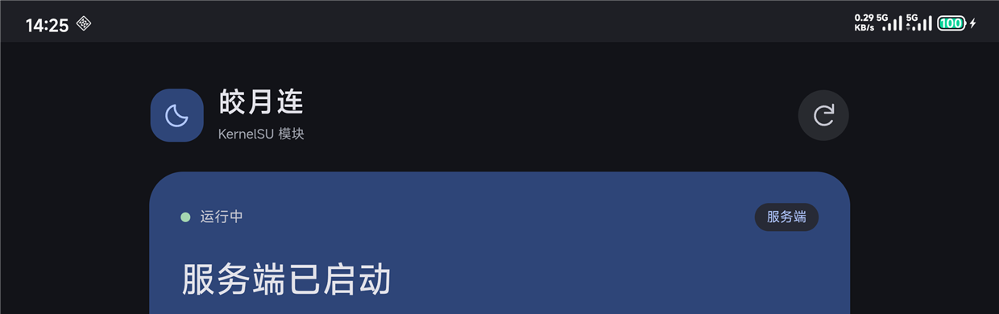
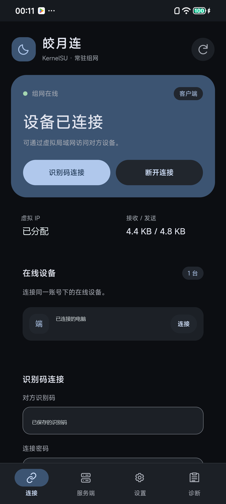

# 真机验证记录

项目仍处于早期测试阶段。下文按版本记录成功和失败的测试；v0.2.0 在同一网络中的传输结果，不能作为移动数据或其他网络下可用的证明。

模块使用原始官方 Linux ARM64 v1.06 核心。具体发布文件和程序的哈希以对应 Release 的 SHA256SUMS 为准。

## v0.2.1：移动数据复测，连接问题未解决

设备：2509FPN0BC，ARM64，Android 16，内核 6.1.93，KernelSU root。日期：2026-11-08（Asia/Shanghai）。手机使用移动数据，与 Windows 测试端处于不同网络。

最终 41 项 Rust 测试已在这台手机的 root 环境中实际执行，41 通过、0 失败，用时 0.05 秒。

本轮已修改并测试以下管理层行为：

- 客户端连接明确使用 VPN 参数 `1`，连接等待延长至 90 秒。
- 保留核心 `conpc` 响应第三、第四字段中的拒绝信息，避免把连接失败统一显示为“对方未开启服务”。
- IPv4 和 IPv6 管理端口限制为本机 root 访问，双栈保护规则的添加与移除已在真机核验。
- 停止服务后，核心新增的两条 FORWARD 规则及 NAT 规则被清理；其他网络规则集合保持不变。

实际安装 v0.2.1 后，服务自动恢复保存的登录；账号文件与已下载核心的 SHA256 都与安装前一致。新版原生 WebUI 已打开，管理器动态配色显示为蓝色，服务端页面显示“服务端已启动”。

实际连接仍未成功：手机作为服务端可以登录并创建 TUN，但 Windows 发起的 `conpc` 请求返回 `no`，没有建立可用隧道。实验 Windows 核心清理至单进程后重新测试，服务端方向仍收到“连接被阻断”提示；客户端方向观察 110 秒也没有建立隧道。登录、创建 TUN 和测试程序通过都不能代替实际数据传输验证。

本轮也完成了原版官方 App 正常界面下的连接操作对照：完全停止模块，正常登录 App，选择同账号下已经启动组网服务的 Windows 测试端并点击连接。截图确认 App 显示“连接被阻断，请关闭两端防火墙后重试”。电脑上残留的实验核心已核实并清理至单进程，官方 App 复测仍显示相同提示。

对该次操作的 JNI 日志检查确认了调用进入和返回 SDK，本次记录不据此给出数值返回码结论。这个正常 App 界面对照与此前 SDK/root 控制会话试验不同；结果只适用于这台新手机、隔离 Windows 测试端和本次移动网络，不能说明官方 App 在其他环境也有相同问题。上述 Toast 是通用错误提示，不能作为防火墙就是根因的证明。

只使用 IPv4 的研究网络命名空间中也未成功建立连接。目前仍未确定根因，不能把 IPv6 作为已确认的原因。手机服务端的问题尚未解决，后续还需要继续排查和实测。

以下是新版真机界面的局部截图，已裁去识别码和设备信息；“服务端已启动”只表示核心服务运行。

## v0.2.0：历史验证，同一网络

设备：Xiaomi 2203121C（thor），ARM64，Android 17，BakaSU/KernelSU 管理器 v4.2.0-rc3。日期：2026-11-07 至 2026-11-08（Asia/Shanghai）。程序安装至真实模块路径，通过 root 私有 Unix socket 与 BakaSU 原生 WebUI 管理。

### 实际传输

每次传输 25,165,824 字节（24 MiB），通过皎月连虚拟地址请求，未直接使用局域网 HTTP 地址。SHA256 为 `206320acc7e9ae70b2e614a2a98ef92a9aa6b3b21cb0aa378c5c16c1a4b0e993`。

| 手机角色 | 数据方向 | 速度 | 完整性 |
| --- | --- | ---: | --- |
| 客户端，连接官方 Windows 服务端 | 手机下载 | 9.34 MiB/s | 字节数、SHA256 一致 |
| 客户端，连接官方 Windows 服务端 | 手机上传 | 9.23 MiB/s | 字节数、SHA256 一致 |
| 服务端，接受官方 Windows 客户端 | Windows 下载 | 13.11 MiB/s | 字节数、SHA256 一致 |
| 服务端，接受官方 Windows 客户端 | Windows 上传 | 7.88 MiB/s | 字节数、SHA256 一致 |

这轮测试的两端位于同一网络，没有进行跨公网、移动数据或不同 NAT 环境测试；上述速度不代表其他网络的性能。

### 自动恢复

- **整机重启**：使用真实 `adb reboot`，未手动执行 start、login 或 connect。Android 启动完成后开机脚本自动运行；重启约 54 秒时隧道探测成功，约 56 秒时额外 ping 3/3 完成。账号、客户端目标、自动连接设置和手机识别码均保留。
- **强杀管理服务**：核对 PID 和可执行文件后发送 SIGKILL。旧核心因父进程死亡退出，看护约 2.5 秒后拉起新管理服务；本轮包括对端等待和重试，约 89 秒后完成恢复及 ping 3/3。
- **强杀官方核心**：核对 PID 和持久目录中的可执行文件后发送 SIGKILL。管理服务发现退出并重建核心，约 29 秒后恢复登录、TUN 路由和 ping 3/3。
- 三次均核对新 PID、核心原始 SHA256 和进程数量，保持一份看护、一份管理服务、一份官方核心。没有依赖 Android App 进程或 `VpnService`。

### 真实 WebUI 与后台

- 在 BakaSU 的真实 WebUI Activity 中打开 Material Design 页面，原生 `ksu.exec` 桥能读取状态并执行操作。
- 点击“断开连接”后保持登录，45 秒内未自动回连。
- 点击“连接设备”后沿用保存的密码，恢复连接；不需要重新输入账号或密码。
- 点击诊断检查，控制通道、核心、账号、虚拟网卡、组网路由、DNS 和隧道数据验证显示正常。
- 强制关闭管理器、使屏幕进入 Dozing，再观察 55 秒；管理服务和核心仍运行，连接与探测仍成功，额外 ping 3/3。
- 真实连接页面的状态栏未出现 VPN 图标；模块使用内核 TUN，不启动 Android VPN 服务。

这验证了短期后台运行和异常恢复，不代表已完成长时间待机、任意系统策略或所有网络的稳定性测试。

### 编译与身份配置

v0.2.0 的 33 项 Rust 测试在实际 ARM64 Android 设备的 root 环境中执行，33 通过、0 失败，运行用时 0.10 秒。覆盖协议隐私与解析、WebSocket、DNS、精确 NAT 清理、有限探测重传、连接配置提交、旧探测隔离、退出登录、首次官方配置初始化、身份迁移，以及按需下载、版本清单校验和更新核心时保留身份。新增清单测试还验证了非官方 URL、无效版本及校验值的拒绝，安装记录在原子替换两侧及重新读取后的识别，以及清单变更后对已安装版本的信任保留。

实际安装无核心的 v0.2.0 模块并重启后，服务保持 `core_missing` 待机，额外观察 10 秒没有自动下载；在真实 WebUI 点击按钮后，从官网取得 3,526,838 字节压缩包，约 4.71 秒内完成 SHA256 校验、安装并恢复保存的登录。重复下载请求没有再次联网。该版本随后与官方 Windows 测试端恢复连接，隧道 ping 3/3 成功。

独立版本清单也完成了真机集成验证：点击原生 WebUI 的“检查核心更新”，实际下载 GitHub 上的 `core-manifest.json`，已安装版本和可用版本均显示为 1.06；检查过程中核心 PID 与连接代次保持不变。在已安装推荐版本时，`core-update` 和 `core-download` 请求均直接返回，不重复联网或重启核心。

随后验证与更新共用的原子安装流程：保持旧核心进程运行，将核心文件移出原私有路径，再触发从官网重新下载同一校验值的 v1.06。安装完成后，管理服务自动切换到新核心 PID，连接代次增加一次，恢复原账号、角色和客户端目标，隧道 ping 3/3 成功。账号文件和设置文件的 SHA256 保持一致，官方配置中的加密 MAC 与 PCID 内容也保持一致。本轮使用的是同版本重新安装；官网未来版本的实际兼容性仍需在该版本发布后验证。

青色默认主题和 BakaSU 原生动态配色均已在真实 WebUI 检查；动态选项读取管理器提供的本机 Material 配色并实际改变界面颜色。自定义颜色、深浅模式、颜色对比度及操作互斥还经过离线浏览器验证。

官方实际读取可执行文件目录中的 `data/config`。最终核心在 `/data/adb/natpierce-rs/core/natpierce` 运行，身份配置位于 `/data/adb/natpierce-rs/core/data/config`；目录 0700，配置 0600。保留官方加密 MAC 和 PCID 字段，只关闭核心的自动登录；首次安装由官方核心生成完整配置。

- 官方核心 SHA256：`7edafed7d1093c27c8ce20458e72ce060243c2204ecdba23aeb6e17ea89cef78`。

测试 HTTP 工具、Windows 独立测试端、研究脚本与账号不包含在发布内容中。v0.2.0 的源码与 Release 模块也不附带官方核心；使用者通过 WebUI 从官方地址下载。安装包与源码包使用明确文件白名单，校验和见发布目录的 SHA256SUMS 文件。

### 公开截图

下图来自 v0.2.0 的真实 KernelSU WebUI，展示采用管理器动态配色的 Material Design 界面。公开副本已对账号、识别码与设备名称等私有内容脱敏。

## 测试边界

目前只有 v0.2.0 在一台设备、同一网络中的数据传输和短期恢复成功记录；v0.2.1 的移动数据连接问题仍未解决。不同 NAT、网络切换、长期待机及更多设备都还没有充分测试。后台测试中的短期 Dozing 观察，不能代替多小时或多天的待机。项目还有许多未测情况，不能保证在其他 Android 系统和网络中有相同表现。
